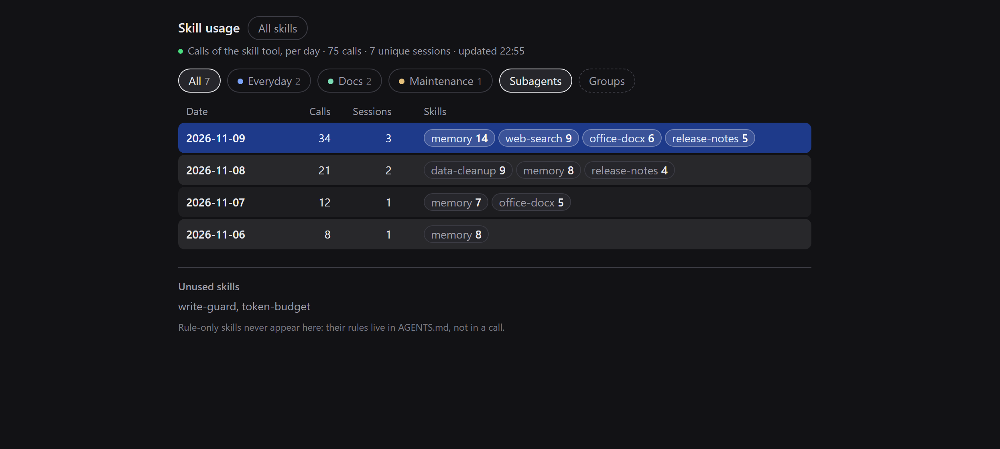
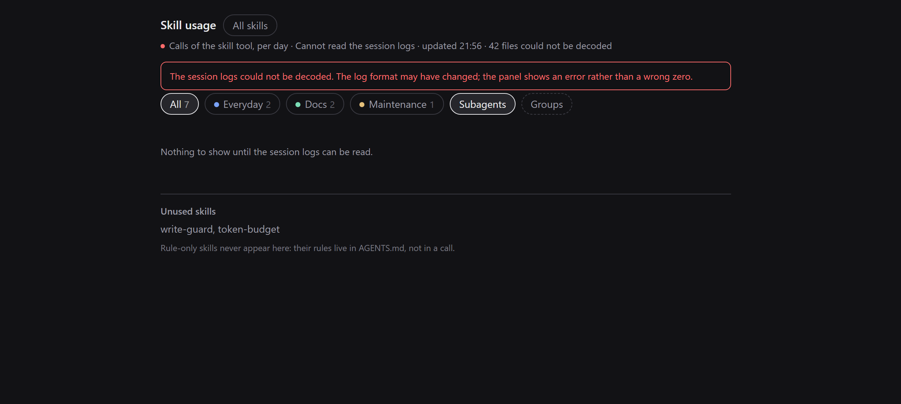

# dsh-skill-history

English | [中文](README.zh.md)

**Which skills do you actually use — and which ones did you install and forget?**

A sidebar panel for [DeepSeek Harness](https://github.com/deepseek-ai/deepseek-harness)
that rebuilds skill usage from your own local session logs: calls per day, the
sessions behind each day, and groups so you can watch the few skills you care
about.



*Sample data. The panel is dark-theme native; the light theme follows the host.*

## Why

Harness shows you *which skills exist*. It does not show you *which ones are
used*. A skill installed months ago and never touched looks exactly like your
most-loaded one.

This panel answers that from the one honest source: the session logs the host
already writes. It counts only calls of the `skill` tool, so the history is
complete from your first session — not from the moment a counter was installed.

Two things are true by design:

- A rule-only skill (rules inlined in `AGENTS.md`, no tool call) has nothing to
  count and stays at `0`. That is a fact, not a bug.
- The panel is **read-only** for sessions: it never opens one, never changes its
  archive state, never edits a skill. The only file it writes is its own group
  list.

## Features

- **Per-day table** — calls, sessions, and the skills used that day; today's row
  is highlighted.
- **Drill down** — day → sessions → one session's skill breakdown with cwd,
  turns, first/last call, and copy-id / copy-path.
- **Groups** — create, rename, colour (8-colour palette plus neutral), and
  multi-select filter. One skill can sit in several groups.
- **All skills** — every installed skill with its creation date and description
  (two-line clamp, click a row to expand), grouped the same way. Built-in skills
  are marked; a skill with zero calls is listed at the bottom of the home view.
- **Live** — session logs are append-only, so a scan decodes only the bytes it
  has not seen; the panel polls every 5 s and keeps the last good snapshot if
  the host is busy.
- **Archived sessions** are marked and stay read-only.
- **Local only** — no network requests, no telemetry.

## Install

Requires DSH `0.2.2-rc.1` or newer.

### From a checkout (works today)

```sh
dsh plugin --profile <profile> add link:/absolute/path/to/dsh-skill-history
```

No `dsh` CLI? Point the plugin manager at the folder instead:

```text
plugin_manager install_bundle  target=/absolute/path/to/dsh-skill-history
```

### From GitHub (after the repository is published)

```sh
dsh plugin --profile <profile> add github:72NG/dsh-skill-history
```

### Desktop app

Open **Settings → Plugins** and install the package through the app's plugin
manager, then refresh the page once. The sidebar gets a bar-chart icon.

### Update / remove

```sh
dsh plugin --profile <profile> update github:72NG/dsh-skill-history
dsh plugin --profile <profile> remove dsh-skill-history
```

## What counts

A call is a `tool/call` event whose `data.name` is `skill`; the skill name is
read from `data.arguments.name` (a JSON string, parsed again). Calls are
attributed to the **local day** of the event time, on the host clock — not the
browser's.

- Subagent sessions (`delegationDepth > 0`) are included by default; turn off
  **Subagents** in the filter bar to exclude them.
- A session file removed from disk stops counting on the next scan.
- A log that cannot be decoded (Node without zstd, unknown log version) shows an
  error banner and `scan.failedFiles`; it never renders a confident `0`.



*What an undecodable log looks like: the panel says so instead of showing zero.*

Data comes from
`$DSH_HOME/sessions/<workspace>/<session>/session.v4.jsonl.zstd`. A session file
is a concatenation of zstd frames — one per flush — so the decoder walks frames
with `engine.bytesWritten` instead of decompressing the whole buffer (Node's
`zstdDecompressSync` would stop at the first frame).

## Compatibility

| Surface | Status |
| --- | --- |
| DeepSeek Harness | `0.2.2-rc.1` Desktop, tested; `engines.dsh` is `>=0.2.2-rc.1` |
| Node | `>=22.19.0` (`zlib.zstdDecompressSync` is required) |
| OS | Windows, macOS, Linux; creation dates prefer `birthtime`, fall back to `mtime` |
| Session log | `session.v4.jsonl.zstd`; an unknown format surfaces as an error, not as zero |

## Privacy

- Reads your session logs — titles, cwd, and `skill` calls — **on this machine
  only**. Nothing is uploaded; the plugin makes no network requests.
- Writes exactly one file: `$DSH_HOME/skill-history/groups.json` (atomic write,
  old file backed up, three backups kept, read back after writing).
- Stores no credentials and does not touch your skill files.

## Limits

- The first scan of a large history costs time (about 15 s for 200 sessions /
  150 MB here). The panel opens immediately with the last snapshot and refreshes
  in the background.
- Only the `skill` tool is counted. Skills whose rules live in `AGENTS.md` stay
  at zero.
- No date-range filter and no CSV export yet.
- No “open this session” action: most sessions behind a historical number are
  archived, and unarchiving them would be a write. Copy the id or path instead.
- Groups and colours are local to your install; there is no sync.

## Development

```sh
npm test          # node --test test/ — no dependencies, no build step
```

| File | Purpose |
| --- | --- |
| `index.js` | Host: session scan, incremental zstd decode, aggregation, two routes |
| `client.js` | Client: sidebar icon and the panel (React from the module loader) |
| `test/parse.test.mjs` | Parser, scan, route, and groups tests |
| `cordis.patch.yml` | One bundle row |
| `locale/*.json` | Plugin-manager title and description (en, zh) |

The host half has no build step and no third-party dependencies. After editing
`client.js`, refresh the page; after editing `index.js`, restart DSH (the loader
caches host modules).

## Migrating from `dsh-skill-stats`

This package was renamed from `dsh-skill-stats`. Your saved groups are still
read from `$DSH_HOME/skill-stats/groups.json`; the first save writes the new
`$DSH_HOME/skill-history/groups.json`. No other state moved.

## License

MIT — see [LICENSE](LICENSE).
