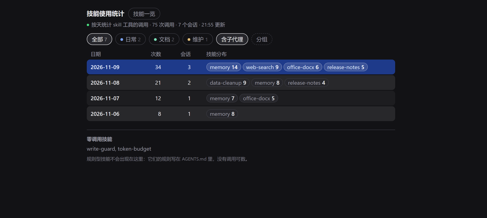
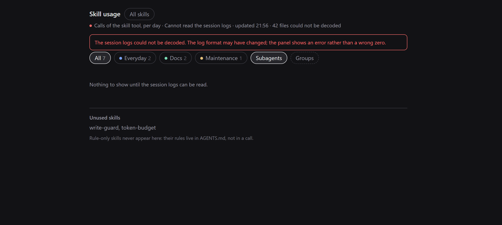

# dsh-skill-history

[English](README.md) | 中文

**你到底在用哪些技能，又有哪些装了就没再碰过？**

一个 DeepSeek Harness 侧栏面板：从你自己的本机会话日志重建技能使用情况——
按天的调用次数、每天背后的会话，以及分组，让你只盯在意的那几个。



*示例数据。面板跟随宿主主题，深色/浅色都可用。*

## 为什么做

DSH 显示**有哪些技能**，不显示**哪些真被用了**。一个装了很久没碰过的技能，
和一个天天在用的技能，在列表里长得一模一样。

这个面板只认一个诚实的来源：宿主本来就在写的会话日志。它只数 `skill` 工具的
调用，所以历史是从**第一个会话**开始就完整的，不是从装上某个计数器那一刻开始。

有两件事是口径，不是缺陷：

- 规则型技能（规则写在 `AGENTS.md` 里、没有工具调用）没有可数的调用，永远显示
  `0`。
- 对会话**只读**：不打开会话、不改归档状态、不改技能文件。唯一写的文件是它自己的
  分组配置。

## 功能

- **按天表**：次数、会话数、当天用到的技能；「今天」那行高亮。
- **下钻**：按天 → 会话列表 → 单个会话的技能明细（cwd、轮次、首末次调用），
  可复制 ID / 路径。
- **分组**：新建、改名、8 色 palette + 中性色、多选筛选；一个技能可以同时在多个组。
- **技能一览**：所有技能的建立日期与描述（默认两行，点整行展开），按同一套分组分区；
  内置技能单独标注；零调用技能列在首页底部。
- **实时**：会话日志是追加写的，增量扫描只解新字节；面板每 5 秒轮询，Host 忙时
  保留上一份快照。
- **归档会话**有标记，保持只读。
- **只在本机**：不联网、不埋点。

## 安装

需要 DSH `0.2.2-rc.1` 或更新版本。

### 从本地目录（现在就能用）

```sh
dsh plugin --profile <profile> add link:/absolute/path/to/dsh-skill-history
```

没有 `dsh` CLI？让插件管理器指向这个目录：

```text
plugin_manager install_bundle  target=/absolute/path/to/dsh-skill-history
```

### 从 GitHub（仓库发布后）

```sh
dsh plugin --profile <profile> add github:nacivageer/dsh-skill-history
```

### 桌面端

打开 **设置 → 插件**，用应用内的插件管理器安装这个包，然后刷新一次页面。
侧栏会出现柱状图图标。

### 更新 / 卸载

```sh
dsh plugin --profile <profile> update github:nacivageer/dsh-skill-history
dsh plugin --profile <profile> remove dsh-skill-history
```

## 统计口径

一次调用 = `tool/call` 事件里 `data.name === "skill"`，技能名取
`data.arguments.name`（JSON 字符串，要二次解析）。调用按事件时间的**本地日**
归档，用的是 Host 时钟，不是浏览器时钟。

- 子代理会话（`delegationDepth > 0`）默认计入；关闭筛选行的「含子代理」即可排除。
- 会话文件从磁盘删除后，下一次扫描就不再计入。
- 日志无法解压（Node 缺 zstd、日志版本变化）会显示错误条与 `scan.failedFiles`，
  **不会**给出一个看起来很确定的 `0`。



*日志读不出来时，面板会这么说，而不是显示 0。*

数据来自 `<DSH_HOME>/sessions/<workspace>/<session>/session.v4.jsonl.zstd`。
一个 session 文件是多帧 zstd 拼接（每次 flush 一帧），所以解码按
`engine.bytesWritten` 逐帧走；整块解只得到第一帧。

## 兼容性

| 面 | 状态 |
| --- | --- |
| DeepSeek Harness | `0.2.2-rc.1` Desktop 实测；`engines.dsh` = `>=0.2.2-rc.1` |
| Node | `>=22.19.0`（需要 `zlib.zstdDecompressSync`） |
| 系统 | Windows / macOS / Linux；建立日期优先 `birthtime`，否则退 `mtime` |
| 会话日志 | `session.v4.jsonl.zstd`；未知格式会显示错误，不会显示 0 |

## 隐私

- 读取会话日志（标题、cwd、`skill` 调用）**只在本机**，不上传，插件不发任何网络请求。
- 只写一个文件：`$DSH_HOME/skill-history/groups.json`（原子写、写前备份、保留 3 份、
  写后回读）。
- 不保存任何凭据，不修改你的技能文件。

## 限制

- 历史很大时首次扫描要时间（本机 200 个会话 / 150 MB 约 15 秒）。面板会先用上一份
  快照打开，后台刷新。
- 只数 `skill` 工具；规则写在 `AGENTS.md` 里的技能永远是 0。
- 暂时没有时间范围筛选，也没有 CSV 导出。
- 没有「打开这个会话」：历史数字背后的会话大多已归档，打开需要先取消归档，那是写操作。
  请复制 ID 或路径。
- 分组与颜色只存在本机，没有同步。

## 开发

```sh
npm test          # node --test test/，无依赖、无构建步骤
```

| 文件 | 作用 |
| --- | --- |
| `index.js` | Host：扫描会话、增量解压、聚合、两条路由 |
| `client.js` | Client：侧栏图标与面板（React 由模块加载器提供） |
| `test/parse.test.mjs` | 解析、扫描、路由、分组测试 |
| `cordis.patch.yml` | 一行 bundle 注册 |
| `locale/*.json` | 插件管理器的标题与描述（en、zh） |

Host 半区无构建、无第三方依赖。改完 `client.js` 刷新页面；改完 `index.js` 需要重启
DSH（loader 对 Host 模块有缓存）。

## 从 `dsh-skill-stats` 迁移

这个包由 `dsh-skill-stats` 改名而来。旧分组仍会从
`$DSH_HOME/skill-stats/groups.json` 读取；第一次保存会写到新的
`$DSH_HOME/skill-history/groups.json`。其余状态没有迁移。

## 许可

MIT，见 [LICENSE](LICENSE)。
